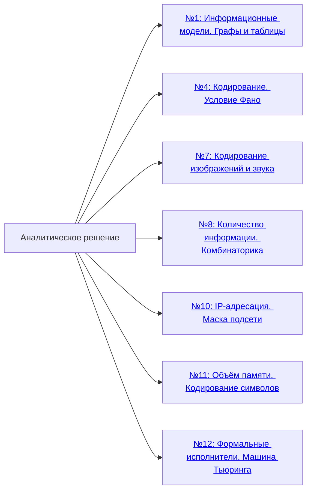
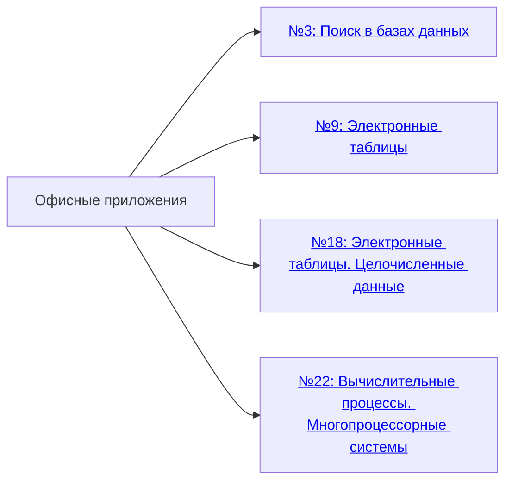
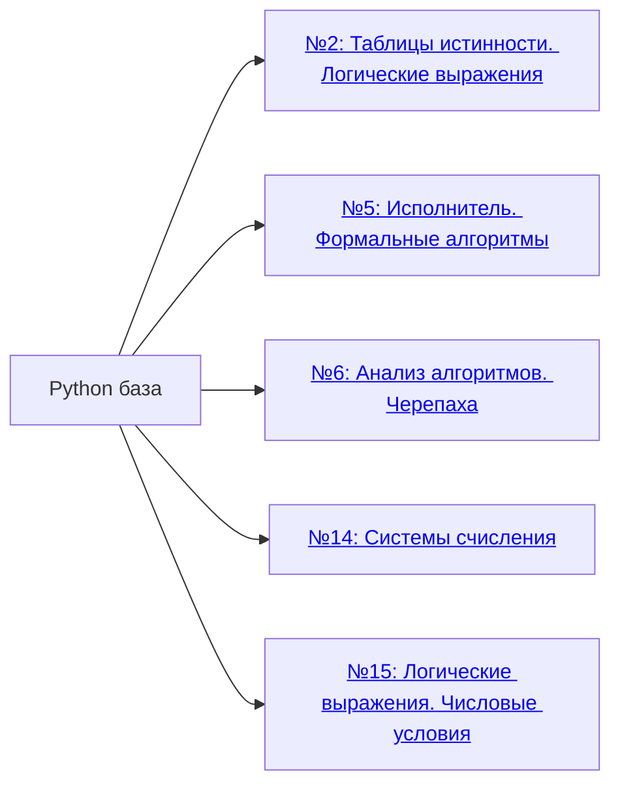
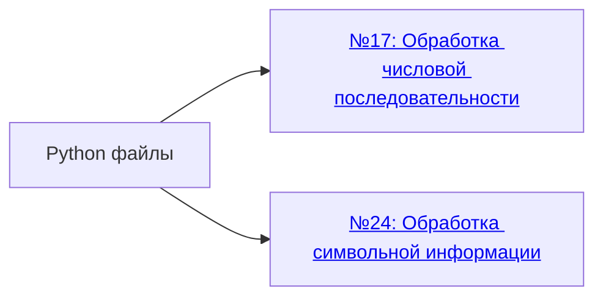
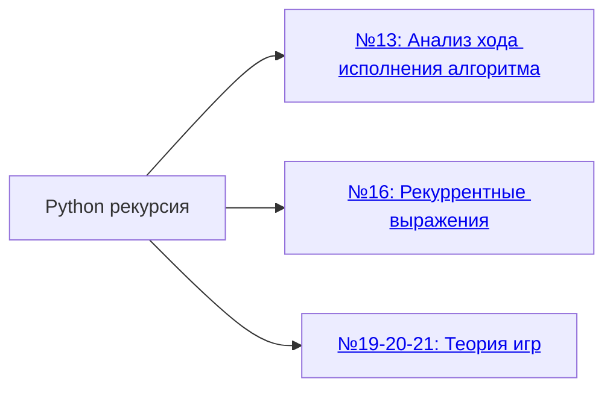
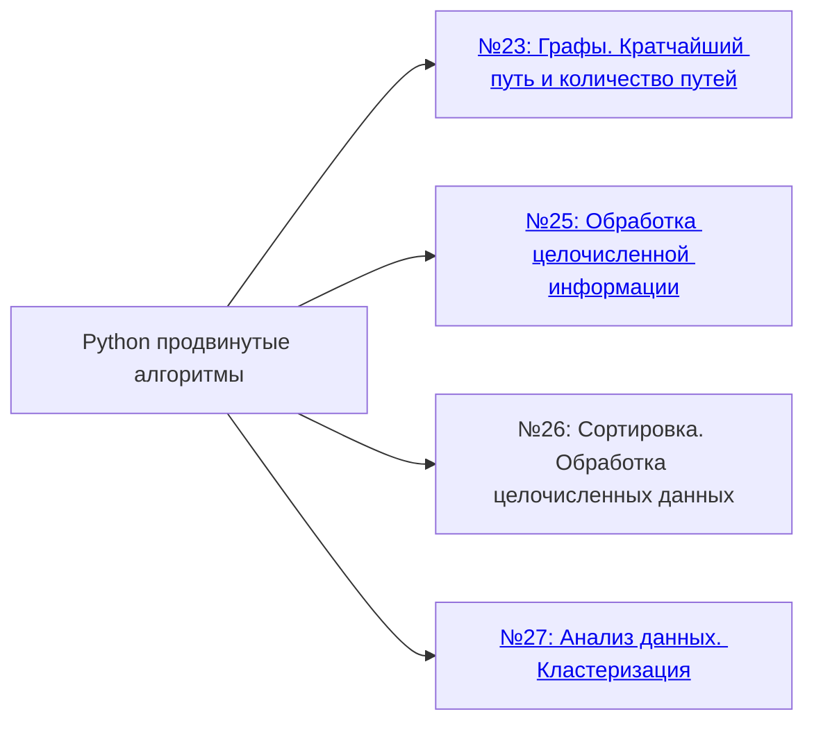

# ЕГЭ. Информатика. Описание заданий

Краткое описание заданий КИМ, рекомендуемое время и шкала перевода баллов.

**Веб-приложение:** [scharfff.github.io/spbpu-inf-course](https://scharfff.github.io/spbpu-inf-course/): теория, решения, трекер прогресса. Внешние курсы открываются кнопкой «Другие курсы».

## 1. Структура экзамена и описание заданий

По проекту спецификации ФИПИ 2027. Уровни: Б (базовый), П (повышенный), В (высокий). 🆕 означает, что тема задания сменилась в 2027 году.

### Часть 1. Задания с 1 по 18

**Баллы:** 18 (по 1 за задание). **Время:** около 85 мин.

| № | Тема | Что нужно уметь | Уровень | Балл | Время | Решили в 2026, % |
|:---:|:---|:---|:---:|:---:|:---:|:---:|
| 1 | Информационные модели. Графы и таблицы | Представлять и считывать данные в разных информационных моделях: сопоставлять граф и таблицу расстояний | Б | 1 | 3 мин | 90,8 |
| 2 | Таблицы истинности. Логические выражения | Строить таблицу истинности и определять порядок переменных в ней | Б | 1 | 3 мин | 78,5 |
| 3 | Поиск в базах данных | Фильтровать данные в `.ods`-таблице, применять ВПР, считать суммы и средние | Б | 1 | 3 мин | 67,8 |
| 4 | Кодирование. Условие Фано | Строить кодовое дерево, проверять условие Фано, вычислять длины кодов | Б | 1 | 2 мин | 71,5 |
| 5 | Исполнитель. Формальные алгоритмы | Выполнять алгоритм формального исполнителя или восстанавливать исходные данные | Б | 1 | 4 мин | 61,1 |
| 6 | Анализ алгоритмов. Черепаха | Определять результат работы алгоритма управления исполнителем | Б | 1 | 4 мин | 63,6 |
| 7 | Кодирование изображений и звука | Вычислять объём файла по разрешению, глубине цвета, частоте дискретизации | Б | 1 | 5 мин | 72,7 |
| 8 | Количество информации. Комбинаторика | Применять правило произведения, считать число кодовых слов или паролей | Б | 1 | 4 мин | 54,9 |
| 9 | Электронные таблицы | Записывать формулы LibreOffice Calc: СУММ, ЕСЛИ, СЧЁТЕСЛИ, СРЗНАЧЕСЛИ, МАКС | Б | 1 | 6 мин | 46,7 |
| 10 | IP-адресация. Маска подсети 🆕 | Находить адрес сети, число адресов, диапазон по IP и маске. Ответ: сумма октетов адреса | Б | 1 | 3 мин | 52,0¹ |
| 11 | Объём памяти. Кодирование символов | Вычислять размер файла паролей/идентификаторов через мощность алфавита и длину | П | 1 | 3 мин | 43,2 |
| 12 | Формальные исполнители. Машина Тьюринга | Выполнять алгоритмы исполнителей с фиксированным набором команд (Редактор, МТ) | П | 1 | 6 мин | 60,3 |
| 13 | Анализ хода исполнения алгоритма 🆕 | Считать количество программ исполнителя с ограничениями на траекторию (бывший №23) | П | 1 | 7 мин | 34,1² |
| 14 | Системы счисления | Переводить числа между системами, считать цифры в записи, решать уравнения с неизвестными цифрами | П | 1 | 3 мин | 45,2 |
| 15 | Логические выражения. Числовые условия | Находить параметр, при котором логическое выражение тождественно истинно | П | 1 | 3 мин | 46,5 |
| 16 | Рекуррентные выражения | Вычислять значение рекуррентно заданной функции | П | 1 | 5 мин | 62,4 |
| 17 | Обработка числовой последовательности | Написать программу (от 10 до 15 строк) обработки последовательности из файла | П | 1 | 13 мин | 35,5 |
| 18 | Электронные таблицы. Целочисленные данные | Использовать `.ods`-таблицу для обработки целочисленных данных (робот-сборщик монет) | П | 1 | 8 мин | 55,6 |

### Часть 2. Задания с 19 по 27

**Баллы:** 11 (за №26 и №27 по 2). **Время:** около 150 мин.

| № | Тема | Что нужно уметь | Уровень | Балл | Время | Решили в 2026, % |
|:---:|:---|:---|:---:|:---:|:---:|:---:|
| 19 | Теория игр. Анализ алгоритма игры | Анализировать алгоритм логической игры, находить выигрышный ход | Б | 1 | 5 мин | 59,3 |
| 20 | Теория игр. Выигрышная стратегия | Находить выигрышную стратегию на 2 хода | П | 1 | 7 мин | 52,5 |
| 21 | Теория игр. Дерево игры | Строить дерево игры и находить выигрышную стратегию | В | 1 | 10 мин | 53,0 |
| 22 | Вычислительные процессы. Многопроцессорные системы | Строить граф зависимостей, вычислять минимальное время выполнения процессов | П | 1 | 7 мин | 41,3 |
| 23 | Графы. Кратчайший путь и количество путей 🆕 | Находить оптимальный путь и число путей в ориентированном ациклическом графе из файла | П | 1 | 12 мин | нет³ |
| 24 | Обработка символьной информации | Написать программу (от 10 до 20 строк) обработки строки из файла | В | 1 | 18 мин | 4,6 |
| 25 | Обработка целочисленной информации | Написать программу (от 10 до 20 строк): маски чисел, делители | В | 1 | 20 мин | 10,9 |
| 26 | Сортировка. Обработка целочисленных данных | Написать программу с сортировкой и обработкой данных из файла | В | 2 | 35 мин | 5,6 |
| 27 | Анализ данных. Кластеризация | Кластеризовать данные из файла, найти характеристики кластеров. Ответ: одна строка из двух чисел | В | 2 | 36 мин | 11,5 |

**Итого:** 27 заданий, **29 первичных баллов**, **3 ч 55 мин** (235 мин).

### Результаты ЕГЭ 2026 (ФИПИ)

«Решили в 2026»: средний процент выполнения задания по всем участникам основного периода ЕГЭ 2026 (для №26 и №27 это процент от максимального балла 2). Источник: [методические рекомендации ФИПИ по итогам ЕГЭ 2026](https://doc.fipi.ru/ege/analiticheskie-i-metodicheskie-materialy/2026/inf_mr_2026.pdf), приложение.

¹ В 2026 году маска подсети была заданием №13. ² В 2026 году анализ хода исполнения алгоритма был заданием №23. ³ Задание на графы появилось в 2027 году, статистики нет. Старое задание №10 (поиск в текстовом процессоре) в 2026 году решили 79,4 % участников.

- Участников основного периода более 131 тыс., средний тестовый балл 58,39.
- Минимальный порог (6 первичных = 40 тестовых) преодолели более 82 % участников, 100 баллов набрали 0,5 %.
- ФИПИ считает умение сформированным, если задание решили не меньше 60 % (базовый уровень), 40 % (повышенный) и 20 % (высокий).
- Хуже всего решены программы: №24 (4,6 %), №26 (5,6 %), №25 (10,9 %), №27 (11,5 %). Лучше всего решены №1 (90,8 %) и №2 (78,5 %).

### Что изменилось в 2027 году (проект ФИПИ)

- **№10**: теперь маска подсети (было №13). Если в ответе IP-адрес, записывают сумму его октетов.
- **Старый №10** (поиск в текстовом процессоре) исключён из экзамена. Материалы остались в ветке [`2026`](https://github.com/scharfff/spbpu-inf-course/tree/2026).
- **№13**: анализ хода исполнения алгоритма, подсчёт программ исполнителя (было №23).
- **№23**: новое задание (графы, кратчайший путь и количество путей в ориентированном ациклическом графе).
- **№27**: один входной файл и ответ одной строкой из двух чисел вместо двух строк.

---
## 2. Папки по подтемам заданий

### 2.1. Аналитическое решение

Решаются вручную, требуют понимания теории и формул. Программирование не нужно.

### 2.2. Офисные приложения

Работа с электронными таблицами в LibreOffice/OpenOffice.

### 2.3. Python база

Базовые конструкции Python: циклы, строки, списки, условия.

### 2.4. Python файлы

Чтение и обработка данных из файлов.

### 2.5. Python рекурсия

Рекурсивные алгоритмы и динамическое программирование.

### 2.6. Python продвинутые алгоритмы

Графы, сортировка и обработка больших данных.

---
## 3. Шкала перевода первичных баллов в тестовые (100-балльная шкала)

Официальная шкала Рособрнадзора 2026 года (такая же, как в 2025). Шкалу 2027 года публикуют ближе к экзамену.

- **Минимальный балл** для аттестата: 6 первичных = **40 тестовых** (подтверждено в отчёте ФИПИ по итогам ЕГЭ 2026).
- Для поступления в вузы, подведомственные Минобрнауки, нужно не ниже **46** тестовых (8 первичных).

| Первичный балл | Тестовый балл |
|:---:|:---:|
| 1 | 7 |
| 2 | 14 |
| 3 | 20 |
| 4 | 27 |
| 5 | 34 |
| 6 | 40 |
| 7 | 43 |
| 8 | 46 |
| 9 | 48 |
| 10 | 51 |
| 11 | 54 |
| 12 | 56 |
| 13 | 59 |
| 14 | 62 |
| 15 | 64 |
| 16 | 67 |
| 17 | 70 |
| 18 | 72 |
| 19 | 75 |
| 20 | 78 |
| 21 | 80 |
| 22 | 83 |
| 23 | 85 |
| 24 | 88 |
| 25 | 90 |
| 26 | 93 |
| 27 | 95 |
| 28 | 98 |
| 29 | 100 |

---
## 4. Ссылки

[Чек-лист пройденных тем по курсу](https://github.com/scharfff/spbpu-inf-course/blob/2027/%D0%A7%D0%B5%D0%BA%D0%BB%D0%B8%D1%81%D1%82_%D0%BF%D1%80%D0%BE%D0%B9%D0%B4%D0%B5%D0%BD%D0%BD%D1%8B%D1%85_%D1%82%D0%B5%D0%BC.md)

[Python для ЕГЭ](https://github.com/scharfff/spbpu-inf-course/blob/2027/Python_%D0%B4%D0%BB%D1%8F_%D0%95%D0%93%D0%AD.md)

[Яндекс Учебник. Персональные занятия](https://education.yandex.ru/teacher-ege/inf/join?token=gAAAAABpi4GuAtw9o40C_BRHyyVCM-CU0SsUC0Zc4JyOTeHjRFh9VTobnY2WLc4kpf6pAm6FwpkXBmXWVsne0C5f0Yg_dsVKIccP8L6otSqgtuBorrf-sxkIM4x2i4vhbAKye3wByzC6EMumFN9hFHATk7Sn3YsLAY2TWDxT99Rwqije9_NkdRhyZpHCWX_Iqpzfv3NA6CbvdTioS21Sthz-3ANPYdiuiA==)

---

**Основано на:** проект КИМ ЕГЭ 2027 (демоверсия, спецификация и кодификатор ФИПИ), методические рекомендации ФИПИ по итогам ЕГЭ 2026, шкала перевода баллов Рособрнадзора 2026, открытый банк заданий.
