# Задание 7. Разбор 15 задач

Рукописные разборы задач №7: изображения, звук, передача и архивация. Задачи идут от простых к сложным, звёздочкой на картинке отмечены сложные. Все разборы одним файлом: [7 задание.pdf](7%20задание.pdf).

## Теория

### Формулы и обозначения

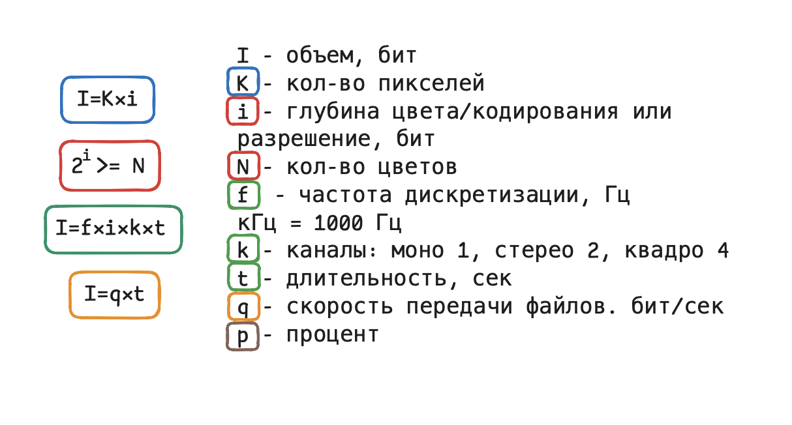

### Формулы сжатия

### Перевод единиц

### Степени двойки

---

## Задачи

| № | Тема | Ответ |
|---|---|---|
| [1](#задача-1) | Биты на 63 цвета | 6 |
| [2](#задача-2) | Ширина квадратного ч/б изображения | 5 |
| [3](#задача-3) | Объём изображения 300 × 400 в байтах | 75000 |
| [4](#задача-4) | Максимум цветов, 1280 × 960, 320 Кбайт | 4 |
| [5](#задача-5) | Минимальный объём, 640 × 320, 64 цвета | 150 |
| [6](#задача-6) | Пакет снимков, ФИПИ | 288 |
| [7](#задача-7) | Максимум цветов, 320 × 480, 40 Кбайт (Е. Джобс) | 4 |
| [8](#задача-8) | Цвет и прозрачность (А. Кабанов) | 1024 |
| [9](#задача-9) | Бит контроля чётности (А. Кабанов) | 64 |
| [10](#задача-10) | Изменение объёма звука после перезаписи | 4375 |
| [11](#задача-11) | Моно → стерео, частота в 3,5 раза больше, ФИПИ | 245 |
| [12](#задача-12) | Частота дискретизации квадрозаписи | 32000 |
| [13](#задача-13) | Упаковка и передача документа | 5 |
| [14](#задача-14) | Экономия трафика, ФИПИ | 91893 |
| [15](#задача-15) | Превью и оригинал логотипа | 63 |

### Задача 1

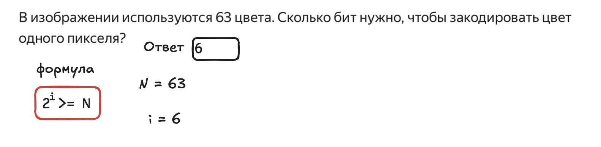

### Задача 2

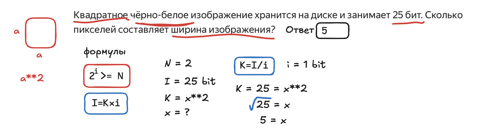

### Задача 3

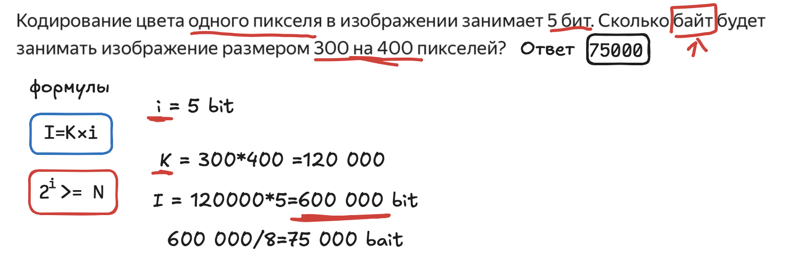

### Задача 4

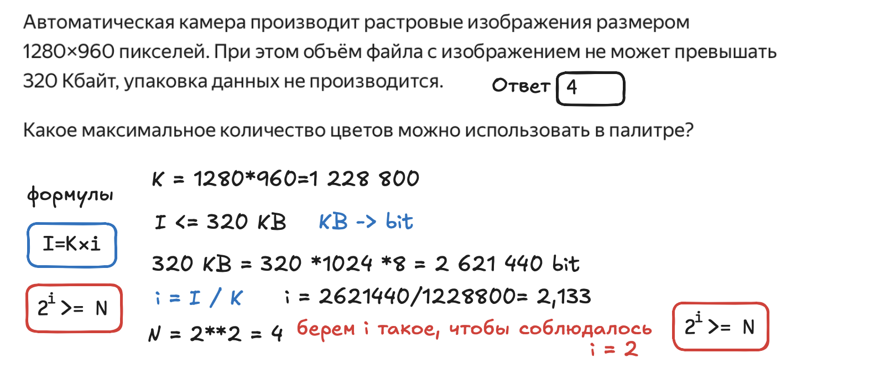

### Задача 5

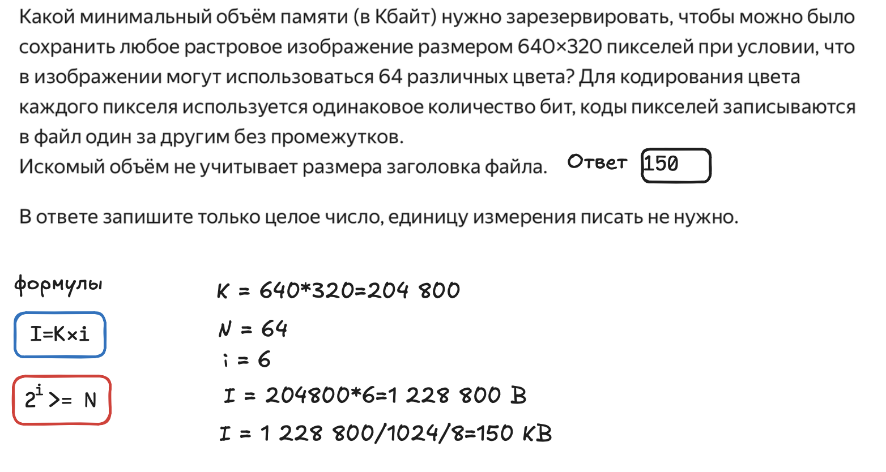

### Задача 6

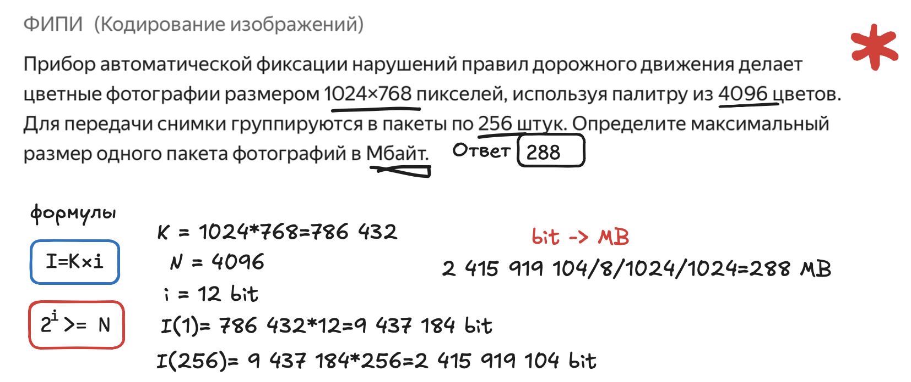

### Задача 7

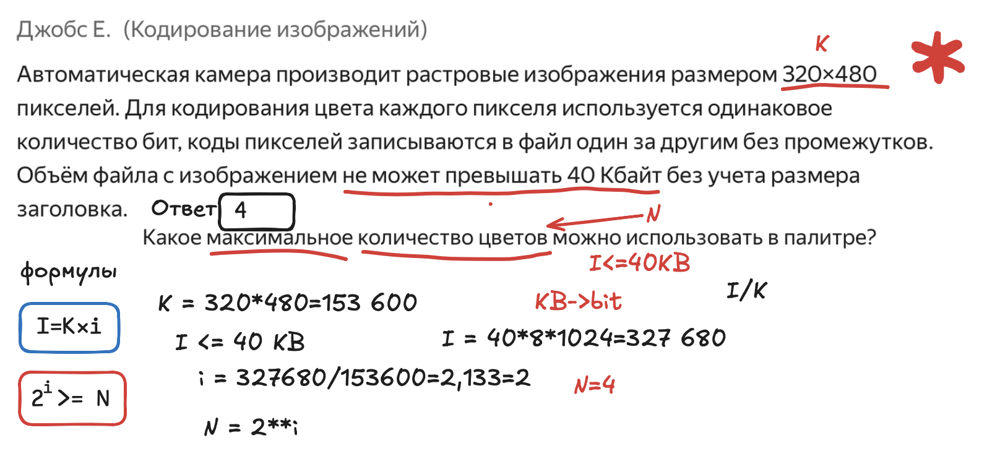

### Задача 8

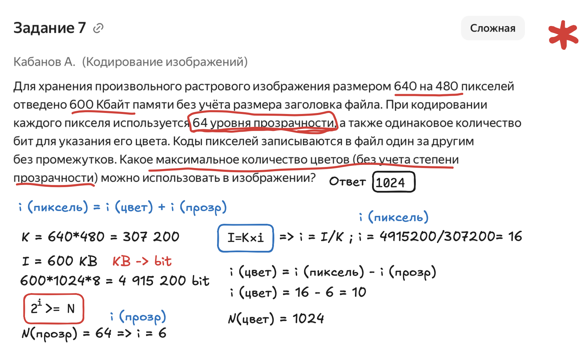

### Задача 9

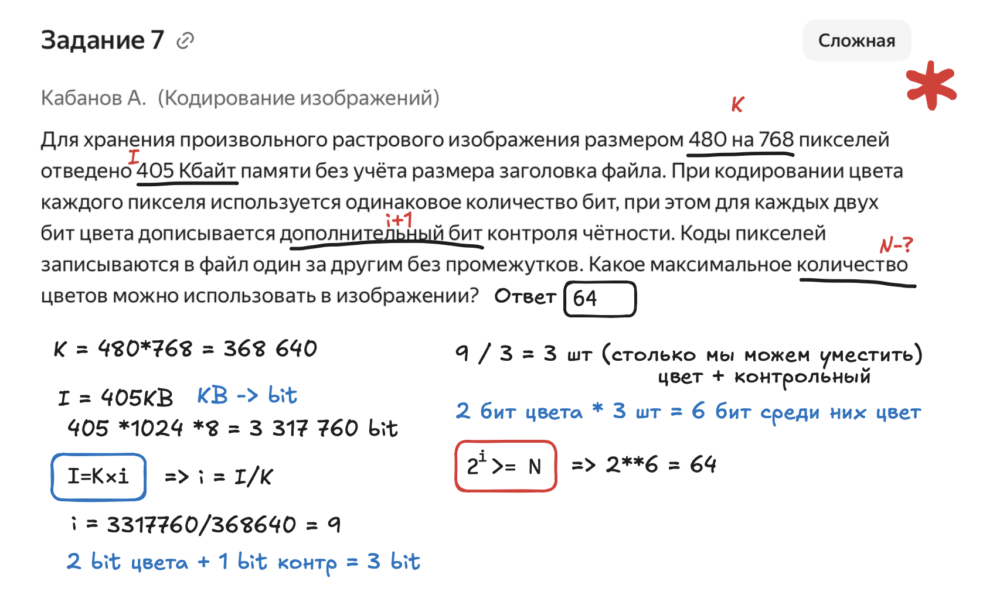

### Задача 10

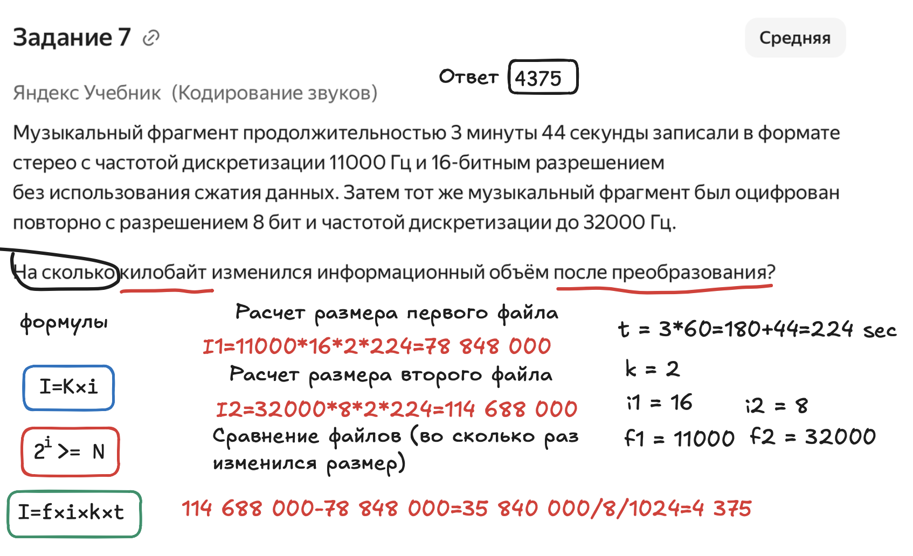

### Задача 11

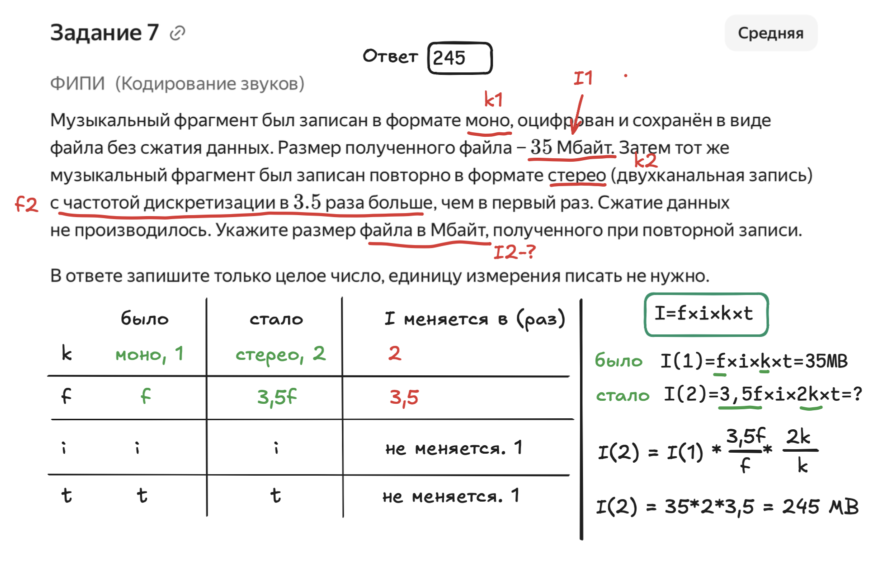

### Задача 12

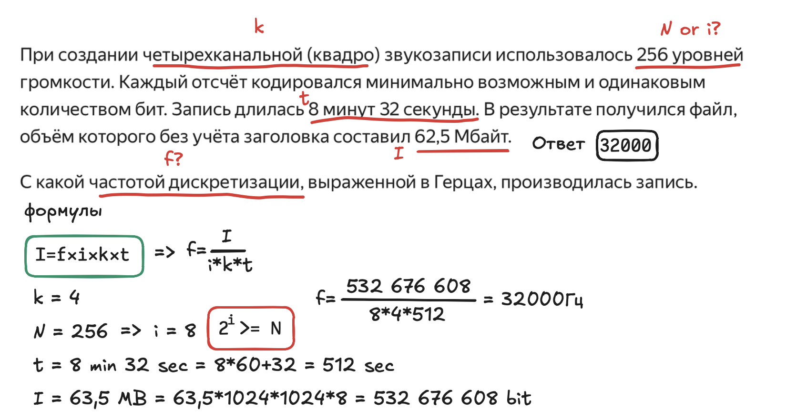

### Задача 13

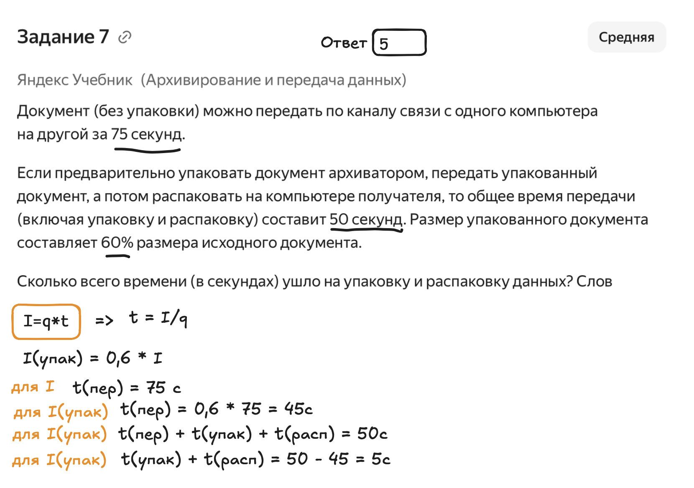

### Задача 14

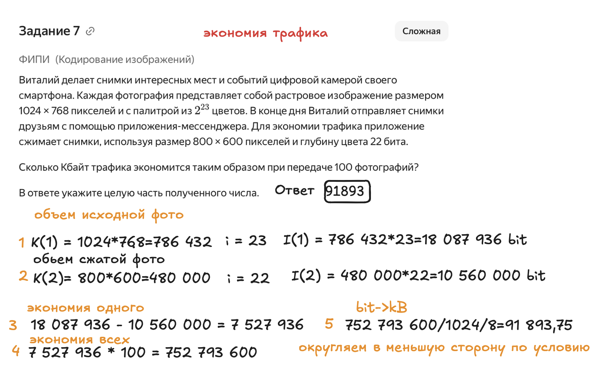

### Задача 15

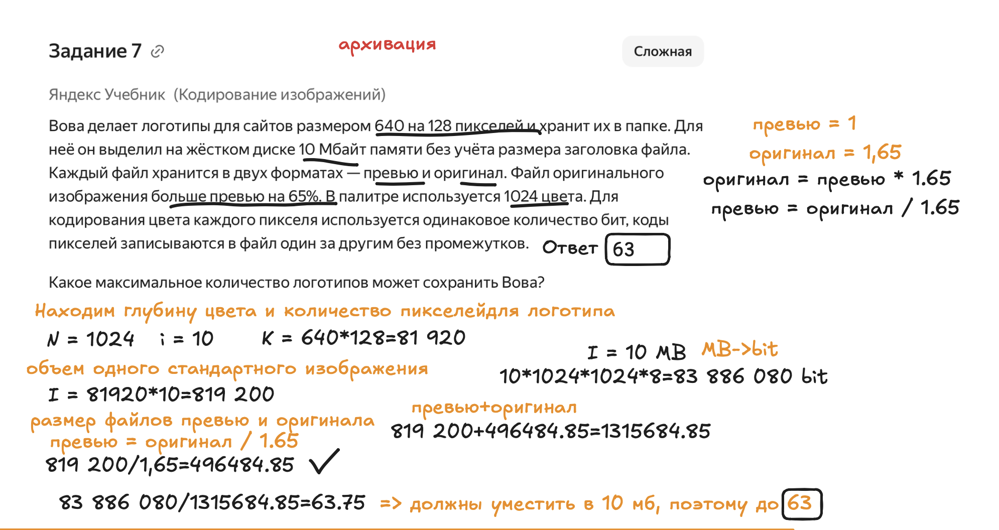

---

Теория к заданию: [README задания 7](../README.md). Все типы с разбором: [N7. Кодирование. Типы задач и разбор](../N7.%20Кодирование.%20Типы%20задач%20и%20разбор.md).
